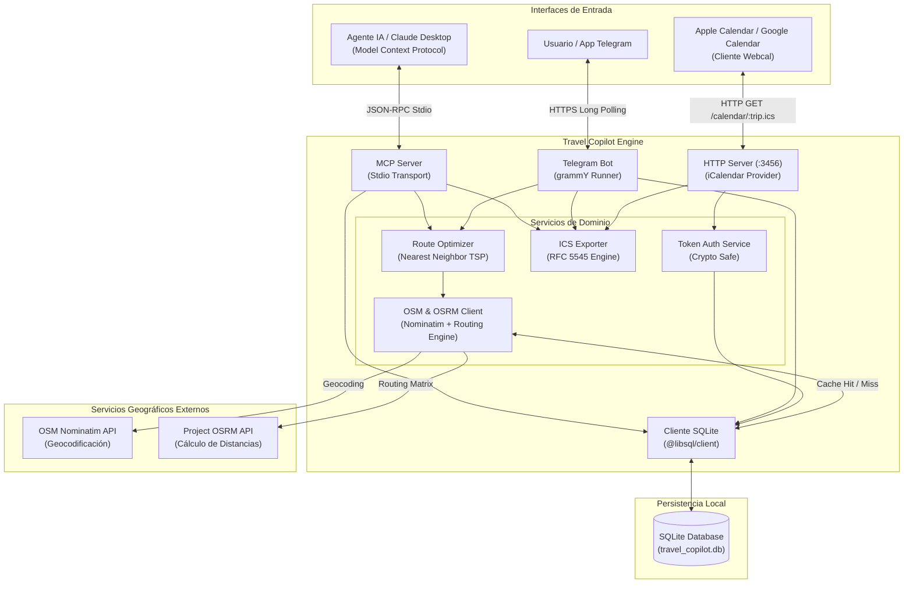
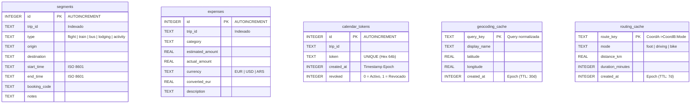

# ✈️ Travel Copilot — Servidor MCP & Asistente Telegram

Un copiloto inteligente y autónomo para la planificación, orquestación y seguimiento de viajes multiciudad. 

El proyecto combina el estándar **Model Context Protocol (MCP)** para interoperar con agentes de IA (Claude Desktop, Cursor, etc.), un bot conversacional en **Telegram** para el usuario final y un motor de suscripción de calendarios en tiempo real (**Webcal / RFC 5545**), respaldado por un optimizador de rutas urbanas basado en **OpenStreetMap (OSRM)** y una base de datos local SQLite de alto rendimiento desacoplada de dependencias C++.

---

## 📑 Tabla de Contenidos

1. [Visión Funcional](#-visión-funcional)
2. [Arquitectura del Sistema](#-arquitectura-del-sistema)
3. [Flujos y Diagramas de Secuencia](#-flujos-y-diagramas-de-secuencia)
4. [Stack Tecnológico y Decisiones Técnicas](#-stack-tecnológico-y-decisiones-técnicas)
5. [Modelo de Datos](#-modelo-de-datos)
6. [Herramientas MCP & Comandos de Telegram](#-herramientas-mcp--comandos-de-telegram)
7. [Instalación y Configuración](#-instalación-y-configuración)
8. [Estructura del Proyecto](#-estructura-del-proyecto)

---

## 🎯 Visión Funcional

El objetivo de **Travel Copilot** es eliminar la fricción habitual al organizar viajes complejos que involucran múltiples transportes, hospedajes, visitas y presupuestos en diversas monedas:

* **Sincronización Viva de Calendario:** Genera un archivo `.ics` y un enlace `webcal://` protegido por token. Cualquier cambio en vuelos, check-ins o excursiones se refleja automáticamente en la app de Calendario (Apple Calendar, Google Calendar, Outlook) del teléfono o computadora del usuario.
* **Optimización de Rutas Urbanas (Problema del Viajante / TSP):** Dado un listado de atracciones en una ciudad (ej. Madrid o Roma), calcula la ruta óptima a pie o en auto para minimizar tiempos muertos y distancias.
* **Control Financiero Multidivisa:** Registra presupuestos estimados y gastos reales soportando monedas combinadas (`EUR`, `USD`, `ARS`), consolidando automáticamente el total en Euros.
* **Canal Dual:** Permite que un agente LLM interactúe mediante llamadas a herramientas MCP (*tools*), o bien que el propio usuario consulte y opere desde un chat privado de **Telegram**.

---

## 🏛️ Arquitectura del Sistema

El sistema corre sobre un único runtime de Node.js estructurado en módulos desacoplados:



---

## 🔄 Flujos y Diagramas de Secuencia

### 1. Optimización de Rutas Urbanas con Doble Capa de Caché

Para respetar los límites de uso de OpenStreetMap y garantizar respuestas por debajo de 200 ms en consultas recurrentes, se implementó una estrategia de caché de dos niveles:

```mermaid
sequenceDiagram
    autonumber
    actor U as Usuario / Telegram
    participant Bot as Telegram Bot
    participant Opt as Route Optimizer
    participant DB as SQLite (@libsql/client)
    participant OSM as OSM / OSRM APIs

    U->>Bot: /ruta Roma | Coliseo, Panteon, Fontana di Trevi
    Bot->>Opt: optimizeAttractionsOrder(paradas, mode='foot')
    
    loop Para cada parada
        Opt->>DB: Consultar geocoding_cache (query_key)
        alt Cache Miss o Expirado (>30 días)
            Opt->>OSM: Request Nominatim Search
            OSM-->>Opt: [lat, lon, display_name]
            Opt->>DB: INSERT/UPDATE geocoding_cache
        else Cache Hit
            DB-->>Opt: [lat, lon, display_name]
        end
    end

    loop Para cada par de coordenadas (A -> B)
        Opt->>DB: Consultar routing_cache (coordA->coordB:mode)
        alt Cache Miss o Expirado (>7 días)
            Opt->>OSM: Request OSRM Route
            OSM-->>Opt: { distance, duration }
            Opt->>DB: INSERT/UPDATE routing_cache
        else Cache Hit
            DB-->>Opt: { distance, duration }
        end
    end

    Opt->>Opt: Resolver secuencia mínima (Algoritmo Voraz / NN)
    Opt-->>Bot: Circuito ordenado + métricas de caché
    Bot-->>U: Itinerario con distancias (km) y tiempos netos a pie
```

---

### 2. Generación y Suscripción Segura a Calendarios

```mermaid
sequenceDiagram
    autonumber
    actor U as Usuario
    participant Bot as Telegram Bot
    participant CalServer as Webcal Server (:3456)
    participant DB as SQLite
    participant CalApp as Apple / Google Calendar

    U->>Bot: /calendario eurotrip-2027
    Bot->>DB: getOrCreateCalendarToken('eurotrip-2027')
    DB-->>Bot: Token criptográfico (hex de 64 caracteres)
    Bot->>Bot: Construir URL: webcal://<HOST>/calendar/eurotrip-2027.ics?token=...
    Bot->>Bot: Generar payload .ics en memoria (Buffer)
    Bot-->>U: Enlace de suscripción + Archivo .ics adjunto

    opt Suscripción Activa
        U->>CalApp: Añadir suscripción con el enlace Webcal
        CalApp->>CalServer: GET /calendar/eurotrip-2027.ics?token=...
        CalServer->>DB: validateCalendarToken('eurotrip-2027', token)
        alt Token Válido
            CalServer->>DB: SELECT * FROM segments WHERE trip_id = ...
            DB-->>CalServer: Lista de tramos
            CalServer-->>CalApp: 200 OK (text/calendar; charset=utf-8)
        else Token Inválido o Revocado
            CalServer-->>CalApp: 401 Unauthorized
        end
    end
```

---

## 💻 Stack Tecnológico y Decisiones Técnicas

* **Node.js (v20+ / v25+) & TypeScript (v5.5):** Construcción modular tipada de extremo a extremo compilada en modo ESM nativo.
* **Persistencia con `@libsql/client` (Turso):**
  * *Motivo técnico:* Tradicionalmente se utiliza `better-sqlite3`, pero este requiere herramientas nativas de compilación C++ (`node-gyp` y Visual Studio en Windows). En versiones de Node.js impares o recientes (como Node 25), los binarios precompilados suelen no estar disponibles. La migración a `@libsql/client` permitió persistencia SQLite local pura (`file:`) basada en WebAssembly/bindings independientes, asegurando portabilidad inmediata en cualquier sistema operativo sin instalar entornos C++.
* **Model Context Protocol (`@modelcontextprotocol/sdk`):** Implementación de transporte `StdioServerTransport` para comunicación JSON-RPC bidireccional estándar con modelos de lenguaje.
* **Telegram Bot (`grammY`):** Framework moderno y seguro para Telegram basado en TypeScript, implementando `InputFile` para streaming directo de archivos `.ics` generados dinámicamente en RAM.
* **Ruteo y Geocodificación Abierta (OpenStreetMap):**
  * **Nominatim:** Georreferenciación de puntos de interés y direcciones turísticas con headers identificatorios y políticas de reintento exponencial (*exponential backoff*).
  * **Project OSRM:** Motor de ruteo de alto rendimiento para estimar distancias métricas y duraciones peatonales/vehiculares reales sobre la red vial.

---

## 🗄️ Modelo de Datos

El motor SQLite inicializa de forma asíncrona seis tablas relacionales preparadas para operaciones concurrentes:



---

## 🛠️ Herramientas MCP & Comandos de Telegram

### Comandos del Bot de Telegram

| Comando | Formato | Descripción |
| :--- | :--- | :--- |
| `/start` | `/start` | Muestra la bienvenida y el listado de comandos disponibles. |
| `/ruta` | `/ruta <ciudad> \| <p1>, <p2>, ...` | Optimiza el orden de visita urbana a pie y detalla distancias/tiempos. |
| `/calendario` | `/calendario <trip_id>` | Genera la URL de suscripción Webcal y envía el archivo `.ics` descargable. |
| `/resumen` | `/resumen <trip_id>` | Lista cronológica de vuelos, transportes, alojamientos y actividades. |
| `/gastos` | `/gastos <trip_id>` | Balance presupuestario consolidado en Euros con detalle en moneda original. |

### Herramientas MCP (Tools para LLMs)

1. **`add_itinerary_segment`**: Registra eventos en el itinerario con validación de tipo (`flight`, `train`, `bus`, `lodging`, `activity`), fechas ISO 8601 y códigos de reserva.
2. **`calculate_transit_time`**: Calcula tiempos y distancias entre dos puntos usando OSM/OSRM y gestiona la caché de rutas.
3. **`optimize_attractions_order`**: Resuelve el circuito óptimo para un array de paradas urbanas.
4. **`export_itinerary_to_ics`**: Renderiza la especificación iCalendar estándar (RFC 5545) a partir de los registros de un viaje.

---

## 🚀 Instalación y Configuración

### 1. Variables de Entorno (`.env`)
Crear un archivo `.env` en la raíz del proyecto:
```ini
PORT_CALENDAR=3456
PUBLIC_HOST=localhost
TELEGRAM_BOT_TOKEN=tu_token_aqui_sin_comillas
```

### 2. Compilación y Ejecución
```bash
# Instalar dependencias puras (sin compiladores C++)
npm install

# Compilar TypeScript a JavaScript
npm run build

# Iniciar servidor MCP, Webcal y Telegram Bot
npm start
```

---

## 📁 Estructura del Proyecto

```text
mcp-travel-copilot/
├── src/
│   ├── db.ts                          # Cliente SQLite (@libsql/client) y esquema DDL
│   ├── index.ts                       # Entrada MCP Server y transporte Stdio
│   ├── telegramBot.ts                 # Handler de comandos y bot grammY
│   └── services/
│       ├── calendarServer.ts          # Servidor HTTP nativo para feeds Webcal
│       ├── icsExporter.ts             # Generador de especificación RFC 5545 (.ics)
│       ├── osmRouting.ts              # Clientes Nominatim/OSRM y gestión de caché
│       ├── routeOptimizer.ts          # Algoritmo de resolución heurística TSP
│       └── tokenAuth.ts               # Generación y validación de tokens de acceso
├── data/
│   └── travel_copilot.db              # Base de datos SQLite local (creada en runtime)
├── Dockerfile                         # Contenedor reproducible de producción
├── docker-compose.yml                 # Orquestación de servicios
├── package.json                       # Dependencias y scripts de ejecución
├── tsconfig.json                      # Configuración del compilador TypeScript
└── README.md                          # Documentación del sistema
```
